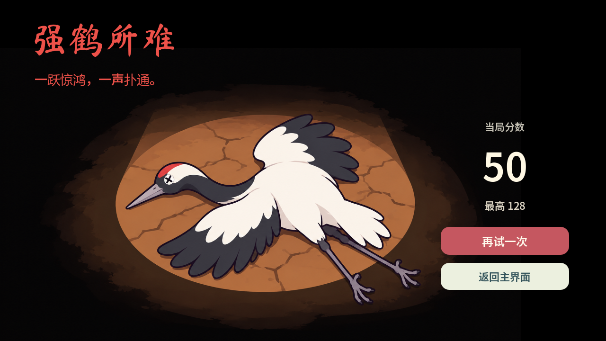

# 小梅逃跑计划

《活侠传》同人安卓横屏小游戏。小梅坐稳，火闪电蹬腿——按住蓄力，松手跳崖，看看这一回能逃多远。

**[下载最新版 APK](https://github.com/Tiger-roll-STU/Xiaomei-escape-plan/releases/latest)** · **[1.0.0 发布页面](https://github.com/Tiger-roll-STU/Xiaomei-escape-plan/releases/tag/v1.0.0)**

## 下载与安装

1. 打开上方发布页面，在 **Assets** 中下载 **小梅逃跑计划.apk**。
2. 将 APK 传到安卓手机，或直接用手机浏览器下载，打开文件安装。
3. 首次安装时，按手机提示允许浏览器或文件管理器安装应用。

支持 **Android 7.0 及以上**，横屏游玩，支持手机向左右两侧翻转；包含 arm64-v8a、armeabi-v7a 和 x86_64 架构。游戏可完全离线游玩，无需账号，不申请相册或存储权限。

同签名的 **1.0.0** 可以直接覆盖安装，保留本机记录和设置。若仍使用早期 **1.1.0**，需要先卸载再安装；**卸载应用或清除应用数据会丢失本机记录和设置**。

## 怎么玩

- **按住蓄力，松手起跳。** 按得越久跳得越远，1.2 秒蓄满，继续按住不会增加跳距。
- 火闪电用腿跳跃，起跳后不能改方向、二次跳跃或飞行。鹤脚踩中崖面才算成功落地。
- 可以跨过近处的山崖。落在下一块得 **1 分**，越过一块再落地得 **2 分**；飞过平台不提前得分，落回原崖不得分。
- 掉下去，这一局就结束。下一局重新出发，挑战自己的记录。

## 每一局，都有不同的选择

点击“开始游戏”直接进入带有随机成长的无限跳跃玩法。**每前进 10 分，暂停并出现一次三选一能力选择**；选中属性增加 1 点，可以反复叠加，新一局重新积累。

| 能力 | 效果 |
| --- | --- |
| 抓地 | 减少冰崖上的滑移 |
| 定力 | 减少横风在地面的推动 |
| 轻踏 | 延长碎崖崩塌前的停留时间 |
| 眼力 | 提前收到飞镖预警，并缩小飞镖的命中判定 |

能力成长的收益逐渐递减，**不改变蓄力时间与跳距的关系**。你熟悉的起跳手感会一直保留。

前路有会滑的冰崖、越摇越厉害直至崩塌的碎崖，也有需要避开危险区域的荆棘崖。横风会推动站在崖上的角色，崖间偶尔会有飞镖向上飞起、随后落下；看准预警和节奏再出发。山崖宽度与间距随分数逐渐变得苛刻，达到 80 分后基础难度封顶，路线继续随机生成。

## 沿途与结算

- 风景随前进分数自然经历白天、黄昏、夜晚和黎明，再回到白天。
- 漂亮地落在新山崖中央，会出现梅花瓣和提示音；这是落地反馈，不额外加分。
- 轻快的 **8-bit BGM** 陪伴逃跑，声音设置可调节总音量，也可静音。
- 本机保存成绩最好的 **10 次完整游戏**。破纪录时，结算页会给出额外提示。
- 死亡大字固定为“强鹤所难”，下方一行小字随本局分数分 **10 档** 变化。

## 语言与暂停

支持 **简体中文、繁體中文、English、日本語、한국어**。在主界面选择语言，设置会保存在本机。

右上角按钮可以暂停，切到后台后返回也会保持暂停。蓄力中暂停会取消本次蓄力，点“继续”后重新操作。

## 关于

本作为玩家制作的《活侠传》同人小游戏，非官方作品。本仓库用于发布安卓版安装包与游玩说明。
